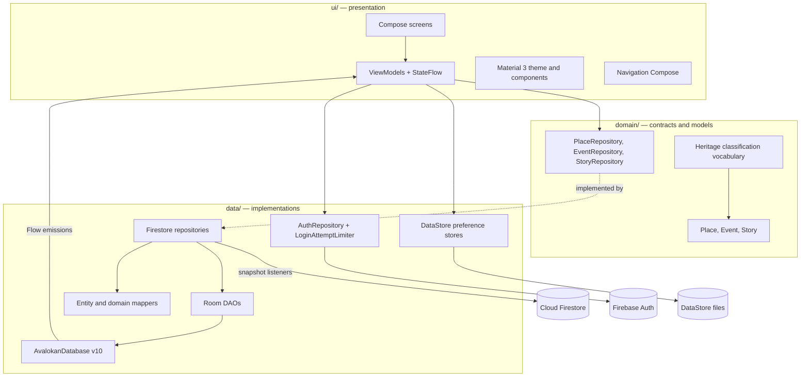
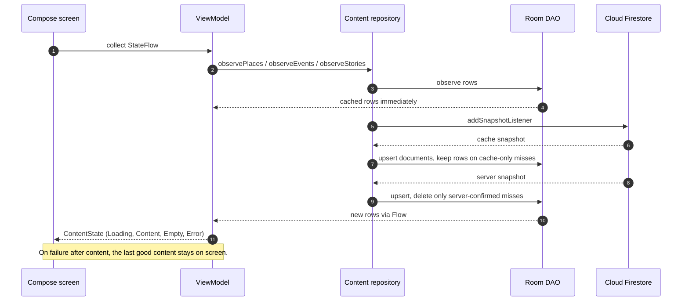
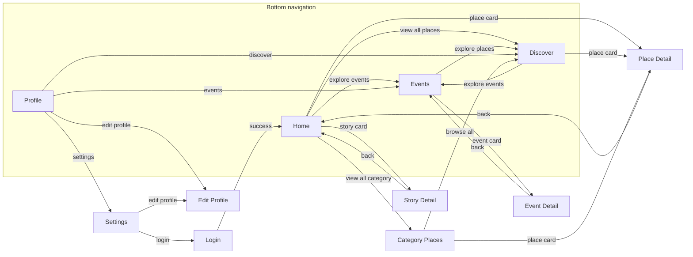
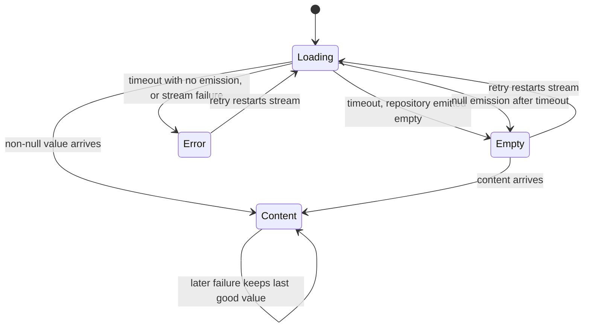
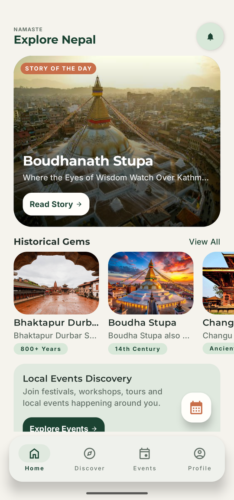
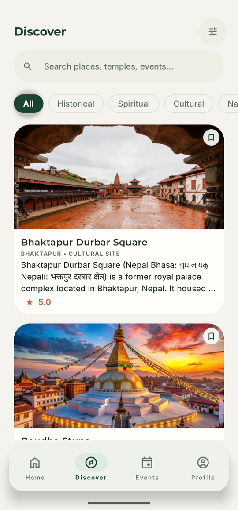
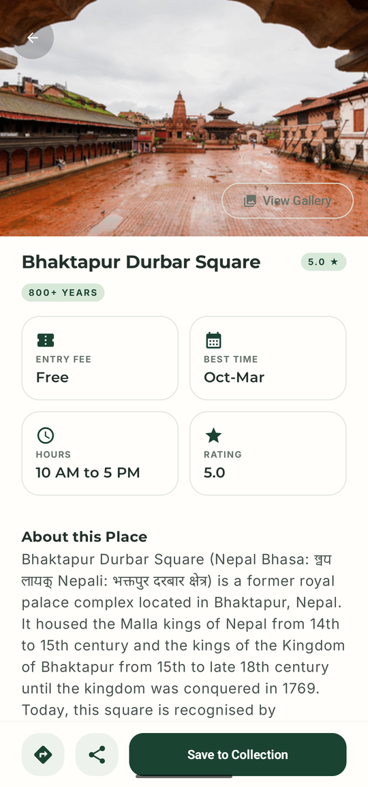
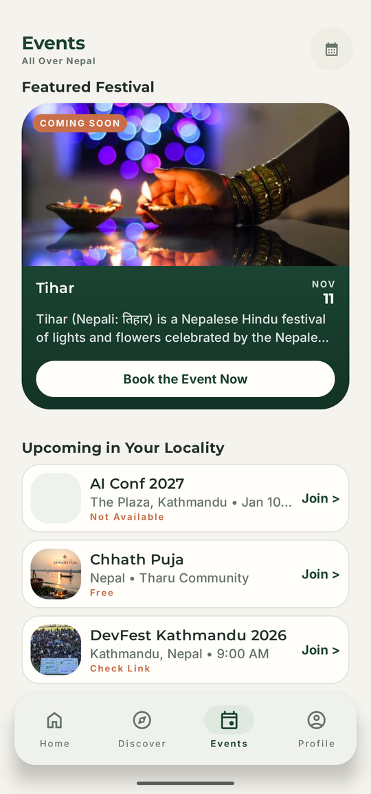
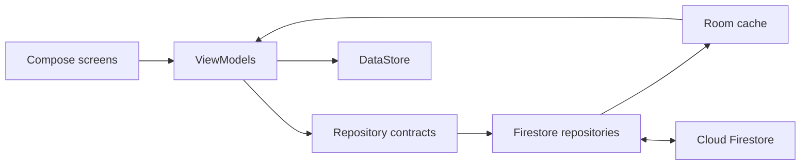

# Avalokan — Public Repository Blueprint

**Document status:** Reference for a future, separate public repository  
**Prepared:** 2026-11-09  
**Scope:** Read-only inspection of the private Avalokan Android project  
**Rule applied:** This document describes only behaviour and structure found in the inspected working tree. It does not reproduce production source, credentials, or private backend content.

> **How to use this document.** Sections 1–4 establish what the app actually is. Sections 5–8 define what can be published and how. Sections 9–11 are reusable drafts and checklists. Section 12 records the decisions that must be made before publication. Nothing here authorises publishing the private repository as-is.

---

## 1. Project overview

Avalokan is a native Android application for discovering Nepal's heritage: historical places, cultural stories, and local events. It is a single-module Kotlin/Jetpack Compose app backed by Firebase Authentication and Cloud Firestore, with a Room cache that acts as the UI's source of truth. Local preferences and collection state live in DataStore.

The app is best described as a **working beta**, not a production service. Browsing, search, place/event/story detail, saving, profiles, and authentication are implemented end to end. Notifications, device location, cross-device collection sync, and in-app booking are not implemented. The private README already states that the app is not production-ready and not published on Google Play; that framing should be preserved in public material.

### What the public repository is for

The public repository should demonstrate:

- A coherent, layered Android architecture with explicit contracts.
- A genuinely offline-first content path built on Room and Firestore listeners.
- A deliberate Loading / Content / Empty / Error state model.
- Conservative handling of editorial data (provenance-gated practical information, no invented metadata).
- Material 3 design-system work and a complete Compose screen set.
- Testable domain rules kept free of Android dependencies.

It should **not** be a mirror of the private application, a deployment guide, or a claim of production readiness.

### Evidence basis

The inspection covered build configuration, the manifest, every Kotlin package under `app/src/main/java/com/example/avalokan`, resources, Room schemas, tests, `README.md`, `docs/`, and Git tracking status. No application file was changed. Findings that depend on a test run are dated explicitly in Section 12.

---

## 2. Verified technology stack

### Build and platform

| Item | Verified value | Evidence |
|---|---|---|
| Build system | Gradle with Kotlin DSL and a version catalog | `build.gradle.kts`, `settings.gradle.kts`, `gradle/libs.versions.toml` |
| Android Gradle Plugin | 9.5.0 | `gradle/libs.versions.toml` |
| Kotlin | 2.2.10 | `gradle/libs.versions.toml` |
| KSP | 2.3.6 | `gradle/libs.versions.toml` |
| Modules | One application module, `:app` | `settings.gradle.kts` |
| Namespace / application ID | `com.example.avalokan` | `app/build.gradle.kts` |
| minSdk | 24 (Android 7.0) | `app/build.gradle.kts`, `README.md` |
| compileSdk / targetSdk | 37 | `app/build.gradle.kts` |
| Java compatibility | 11 | `app/build.gradle.kts` |
| versionCode / versionName | 1 / `1.0` | `app/build.gradle.kts`, `app/release/output-metadata.json` |
| Release optimisation | Explicitly disabled (`optimization.enable = false`) | `app/build.gradle.kts` |
| Room schema export | `app/schemas/` | `app/build.gradle.kts` |

**Version-label discrepancy:** the current source declares `versionName = "1.0"`, while the latest commit message labels the work as “Avalokan 1.4.0”. Public documentation should not repeat either number as a product claim without reconciling them first.

### Libraries

| Area | Library | Version |
|---|---|---|
| UI | Jetpack Compose BOM | 2026.02.01 |
| UI | Material 3 | 1.4.0 |
| UI | Compose Foundation / Foundation Layout | 1.12.1 |
| UI | Activity Compose | 1.13.0 |
| UI | Material Icons Extended | via Compose BOM |
| UI | Core Splashscreen | 1.0.1 |
| Navigation | Navigation Compose / Runtime KTX | 2.10.1 |
| Lifecycle | Lifecycle Runtime KTX | 2.11.0 |
| DI | Hilt | 2.60.1 |
| DI | Hilt Navigation Compose | 1.2.0 |
| Backend | Firebase BOM | 34.19.0 |
| Backend | Cloud Firestore | via Firebase BOM |
| Backend | Firebase Authentication | via Firebase BOM |
| Local database | Room 3 (runtime, common, compiler) | 3.0.3 |
| Preferences | DataStore Preferences | 1.1.7 |
| Images | Coil Compose | 2.6.0 |
| Auth UI | AndroidX Credential Manager | 1.3.0 |
| Auth UI | Google Identity (Google ID token) | 1.1.1 |
| Core | AndroidX Core KTX | 1.19.0 |
| Testing | JUnit 4 | 4.13.2 |
| Testing | kotlinx-coroutines-test | 1.10.2 |
| Testing | Turbine | 1.2.1 |
| Testing | AndroidX Test JUnit / Espresso | 1.3.0 / 3.7.0 |
| Testing | Compose UI Test | via Compose BOM |

### What is not present

The dependency and source inspection found no Firebase Analytics, Crashlytics, Cloud Storage, Cloud Messaging/FCM, Remote Config, WorkManager, Play Services Location, Maps SDK, Billing, or App Check integration. The current private README lists “Firebase Analytics” in its technology table; that statement is not supported by the build dependencies and should be corrected in public documentation.

### Build prerequisites

The build requires both a Firebase Android configuration file and a local properties file:

- `app/google-services.json` must exist.
- `secrets.properties` must define `GOOGLE_SERVER_CLIENT_ID`.
- The Google Services Gradle plugin is applied.
- The web client ID is injected as a generated string resource.

This is private-project setup and must not be presented as a public quick-start without a dedicated demo Firebase project and safe templates.

---

## 3. Actual architecture overview

### 3.1 Shape of the app

Avalokan is a layered MVVM application in one Gradle module, organised by package rather than by feature module:

- `ui/` — Compose screens, screen-level ViewModels, theme, navigation, shared UI components.
- `domain/` — UI-facing models, repository contracts for places/events/stories, and the heritage classification vocabulary.
- `data/` — Firestore repositories, Room entities/DAOs/database, mappers, DataStore stores, authentication, security helpers, and Hilt modules.

ViewModels depend on repository interfaces and local preference contracts. They never expose Room entities or Firestore `DocumentSnapshot` objects to the UI.



**Boundary note:** `AuthRepository` is a concrete class in the data layer, not an interface in `domain/`. The `UserRepository` contract also lives in the data layer. Only the three content repositories are expressed as domain interfaces. This is the actual structure; public documentation should not claim a uniformly abstracted domain layer.

### 3.2 Package layout

```text
com.example.avalokan
├── AvalokanApplication.kt        # Hilt app; anonymous Firebase bootstrap
├── AvalokanApp.kt                # Scaffold, bottom bar, tab navigation helper
├── MainActivity.kt               # Splash screen, edge-to-edge, theme state
├── data
│   ├── AvalokanDatabase.kt       # Room database, version 10
│   ├── AvalokanMigrations.kt     # 9 → 10 migration
│   ├── Converters.kt
│   ├── auth/                     # AuthRepository, AuthState, LoginAttemptLimiter
│   ├── classification/           # LegacyClassificationCatalog fallback seed
│   ├── di/                       # Hilt SingletonComponent modules
│   ├── event/                    # EventItem, EventDao, mappers, repository
│   ├── firestore/                # Shared cached-collection plumbing and policy
│   ├── local/                    # PreferencesStore, UserPreferences, AvatarStore
│   ├── place/                    # PlaceItem, PlaceDao, mappers, repository
│   ├── security/                 # Input validation, safe URL handling
│   ├── story/                    # StoryItem, StoryDao, mappers, repository
│   └── user/                     # UserProfile, FirestoreUserRepository
├── domain
│   ├── classification/           # Stable keys, heritage groups, event semantics
│   ├── model/                    # Place, Event, Story, event presentation rules
│   └── repository/               # Place, Event, Story repository interfaces
└── ui
    ├── auth/                     # Login / sign-up screen and ViewModel
    ├── category/                 # "View All" category listing
    ├── common/                   # ContentState, external links
    ├── components/               # Shared cards, state views, loading skeletons
    ├── detail/                   # Place, event, story detail + Body
    ├── discover/                 # Search, filters, save toggles
    ├── events/                   # Featured festival and upcoming list
    ├── home/                     # Hero story, gems, recent discoveries
    ├── navigation/               # Destinations and NavHost
    ├── profile/                  # Profile, edit profile, shared ViewModel
    ├── settings/                 # Theme, notifications, cache, account
    └── theme/                    # Color, type, shape, spacing, category accents
```

### 3.3 The content data path

All three content types use the same shared mechanism:

1. A repository exposes a `Flow` sourced from its Room DAO.
2. The same repository opens a Firestore snapshot listener for its collection.
3. Snapshot documents are mapped to Room entities and written into the cache.
4. Room re-emits; the UI observes Room, not Firestore.
5. An initial empty Firestore cache snapshot is not allowed to wipe Room.
6. A document is deleted from Room only when Firestore reports a **server-confirmed** absence.
7. Listener failures leave the last good Room cache intact.
8. Retry/refresh restarts the stream and requests a server read (`Source.SERVER`).



The shared cache plumbing lives in `data/firestore/FirestoreCachedCollection.kt`; the deletion/replacement rules are isolated in `data/firestore/FirestoreCachePolicy.kt` so they can be unit-tested without a Firebase emulator.

### 3.4 Room and the “disposable cache” contract

- Database version is 10; schemas for versions 8, 9, and 10 are exported.
- The database is explicitly documented as a **disposable, Firestore-derived cache**.
- Destructive migrations are allowed while that contract holds.
- A real `9 → 10` migration adds the classification columns to both places and events so an offline launch after an update does not flash an empty screen.
- Entities are separate from domain models; mappers form the boundary.
- Converters handle list/string fields.
- The cache stores content only. User-created state (saved places, favourites, visited places, avatar URI, theme, notification preference) is not in Room.

**Important caveat for public documentation:** if user-created data is ever stored in Room, the destructive-migration policy must be removed. This is stated in the database source and should be repeated in the architecture doc.

### 3.5 DataStore

Two preference stores exist:

| Store | Purpose | Notable contents |
|---|---|---|
| `user_prefs` | Device-local user state | Theme choice, saved place IDs, favourite event IDs, visited place IDs, notification preference, local avatar URI |
| `login_attempts` | Sign-in throttling | Per-email attempt count and lockout timestamp; 5 attempts, 15-minute lockout |

Both use corruption handlers that fall back to empty preferences. Cloud backup excludes both DataStore files and the Room database. The device-transfer rules also exclude `login_attempts` and Room, but `user_prefs` is not excluded from device transfer, so theme, saved IDs, and the avatar URI can move to a new device during a direct transfer. Neither path synchronises collections through Firestore.

Saved/favourite/visited collections are **device-local**. They are not synchronised through Firestore. This must be stated plainly in public documentation.

### 3.6 Authentication

- The application bootstraps an **anonymous Firebase session** on a background thread when no user is signed in. This gives a stable identity for personalisation without forcing a login wall.
- Email/password sign-up and sign-in are implemented, with shared client-side email and password validation.
- Google sign-in uses Credential Manager with a Google ID token and Firebase credential exchange.
- If the current user is anonymous, Google credentials are **linked** to that anonymous account rather than replacing it.
- Failed credential attempts are counted per email; after five failures the account is locked locally for 15 minutes.
- Signing out calls Firebase sign-out and then starts a new anonymous session; Settings navigates to Login and clears the back stack.
- Auth state is observed as a `Flow<AuthState>` with `isAuthenticated`, `isAnonymous`, and `uid`.
- Passwords are never stored or pre-hashed by the app.

There is no email verification flow, password reset flow, account deletion flow, or multi-factor flow in the inspected source.

### 3.7 Navigation

`NavDestination` is a sealed interface of routes:

| Destination | Route | Notes |
|---|---|---|
| Home | `home` | Start destination; bottom tab |
| Discover | `discover` | Bottom tab |
| Events | `events` | Bottom tab |
| Profile | `profile` | Bottom tab |
| Settings | `settings` | Pushed from Profile |
| Login | `login` | Pushed from Settings; success clears back stack |
| Edit Profile | `edit_profile` | Shares the Profile back-stack entry's ViewModel |
| Category Places | `category/{category}` | Encoded category argument |
| Place Detail | `place_detail/{placeId}` | Detail body |
| Event Detail | `event_detail/{eventId}` | Detail body |
| Story Detail | `story_detail/{storyId}` | Detail body |

Tab switching goes through one helper that pops to the start destination with `saveState`, uses `launchSingleTop`, and restores state. The bottom bar is shown only on the four tab routes.



Detail screens use `navigateUp()` for back navigation. There are no deep links or app links.

### 3.8 State management and the explicit state model

ViewModels expose `StateFlow` values built with `stateIn(..., SharingStarted.WhileSubscribed(5_000), ...)`. Filtering and derived lists use `combine` and `flatMapLatest`; retry bumps a reload counter that restarts the repository stream.

The content state model is a deliberate four-state sealed interface:



- `Loading` means no usable value yet.
- `Content` carries the value.
- `Empty` means the repository answered with nothing.
- `Error` carries an optional message.
- The default loading window is **2,000 ms** (`CONTENT_LOADING_TIMEOUT_MS`).
- A `null` item stream is held as Loading until the timeout; a non-null value settles immediately.
- A failure after content has arrived does not replace the content with an error.
- List streams map an empty list to `Empty` only after the loading window, preventing a cached-empty cold start from flashing an empty state before the network answers.
- Screens use skeleton/loading components and a shared `DetailBody<T>` wrapper with retry.
- Discover distinguishes “nothing loaded” from “this filter/search has no matches” and offers suggestions.

This state model is one of the strongest public artefacts. It is backed by a dedicated test class (`ContentStateTest`) and the inspected run showed 46 state-related tests passing.

### 3.9 Dependency injection

Hilt is installed on `SingletonComponent`:

- `provideFirestore()` — singleton `FirebaseFirestore`.
- `provideDatabase()` — singleton Room database with the `MIGRATION_9_10`.
- `provideUserPreferences()` — singleton `PreferencesStore`.
- DAO providers for place, event, and story.
- `@Binds` bindings from the three domain repository interfaces to their Firestore implementations.
- `@Binds` bindings for `AvatarStore`, `UserRepository`, and `PreferencesStore`.

There are no custom scopes or subcomponents. `MainViewModel` intentionally depends only on `PreferencesStore` so startup does not initialise Room or Firestore on the first-frame path. That is an explicit startup design decision, not an accident.

### 3.10 Material 3 and the design system

- Custom light and dark colour schemes built around forest green, sage, sand, and terracotta, with warm off-white surfaces.
- Typography uses bundled Montserrat for headings and Inter for body text.
- Material 3 `Shapes` plus editorial aliases for cards and buttons.
- A spacing scale with semantic aliases (side padding, section vertical, grid).
- Category-specific accent colours for the five heritage discovery groups.
- Theme preference supports System, Light, and Dark, stored in DataStore and applied at the Activity level.
- Edge-to-edge layout and a splash screen are configured.
- Dynamic colour support exists behind a `dynamicColor` parameter that defaults to `false`; the app entry point does not enable it, so the fixed brand schemes are what appear in the product.

### 3.11 Domain rules kept out of the UI

- `HeritageClassification` is Android-free and uses stable string keys, not enum ordinals. Unknown keys are preserved by the data layer and ignored by typed accessors.
- Event presentation semantics (`EventSemantics`) are Android-free: they decide the “About” title, price label, and whether a call-to-action is allowed. A CTA is not shown without a usable link; a technology conference is not presented as a festival.
- Place practical information is provenance-gated: entry fee, best time, hours, and similar facts are hidden unless the data has a source/verification signal.
- `InputValidation` validates email and document IDs before they reach navigation, Room, or Firestore paths.
- `SafeUri` normalises URLs and rejects non-HTTP(S) schemes before opening external links.

### 3.12 Important architectural decisions

| Decision | Rationale visible in the code |
|---|---|
| Room is the UI's source of truth | Screens survive offline and do not wait on Firestore. |
| Firestore cache is disposable | Content is server-derived; destructive migrations are acceptable. |
| Keep one real migration (9 → 10) | Avoids an empty offline screen immediately after an update. |
| Explicit four-state content model | Prevents cold-start empties from looking like failures and failures from erasing good content. |
| Server-confirmed deletes only | Firestore's local cache can report a document missing before the server agrees. |
| Provenance-gated practical info | Avoids presenting unsourced entry fees, hours, or travel advice as fact. |
| Stable classification keys | Curators can edit Firestore without depending on Kotlin enum order. |
| CTA requires a link | Prevents dead “Book Now” buttons. |
| Local avatar copied into app storage | A `content://` picker URI is not valid on another device or after the grant expires. |
| Anonymous-first auth, then link | No login wall, but Google/email can upgrade the anonymous identity. |
| Small startup graph | `MainViewModel` only needs theme preference; Room/Firestore initialise later. |

---

## 4. Feature inventory and implementation status

**Status legend:** Implemented = complete in the inspected source. Implemented (local) = works but persists only on the device. Partial = some behaviour exists but a dependency or edge is missing. UI-only = visual interaction without persistence or backend effect. Placeholder = visible control with no working action. Not implemented = no implementation found.

| Feature | Implementation status | Technologies | Public documentation recommendation |
|---|---|---|---|
| Anonymous-first session bootstrap | Implemented | Firebase Auth, coroutines | Document as an onboarding decision; do not show UID logging. |
| Email/password sign-up and sign-in | Implemented | Firebase Auth, ViewModel/StateFlow | Document validation rules and error mapping at a high level. |
| Google sign-in / account linking | Implemented | Credential Manager, Google Identity, Firebase Auth | Document the link-not-replace behaviour; use a demo OAuth client. |
| Login attempt lockout | Implemented | DataStore, SHA-based email key | Document the 5-attempt / 15-minute policy; no real emails. |
| Home feed | Implemented | Compose, Room/Flow, Coil | Include a screenshot and a short feature description. |
| “Story of the Day” hero | Implemented | Compose, Coil | Document as an editorial hero, not a recommendation engine. |
| Historical Gems and Recent Discoveries | Implemented | Compose, repository order | Explain that order is editorial/featured, not rating-based. |
| Home notifications bell | Placeholder | Compose | Mention as a known limitation; do not imply notifications exist. |
| Discover browse and search | Implemented | Compose, client-side filtering over Room | Document that search/filtering is in-memory over cached content. |
| Five heritage-group filters | Implemented | Heritage classification vocabulary | Document the taxonomy and stable-key design. |
| Empty / no-results states with suggestions | Implemented | `ContentState`, Compose | Strong documentation candidate; include state screenshots. |
| Save places | Implemented (local) | DataStore | State clearly that saves are device-local. |
| “View All” category listing | Implemented | Navigation argument, Room | Document route argument encoding and reuse. |
| Events list | Implemented | Compose, Room | Document the featured/upcoming split. |
| Featured festival gating | Implemented | Event semantics | Explain why a non-festival event is not labelled as a festival. |
| Event detail with favourite | Implemented (local favourite) | Compose, DataStore | Document the local-only nature. |
| Event CTA / external link | Implemented, conditionally | `safeHttpUrl`, event semantics | Explain the “no link, no CTA” rule. |
| Event price display | Implemented, provenance-aware | Event semantics | Document price-label rules and unknown pricing. |
| Place detail | Implemented | Compose, Room | Primary screenshot and architecture example. |
| Provenance-gated practical info | Implemented | Domain/data fields | Strong engineering highlight; explain hiding vs. guessing. |
| Saved / visited place toggles | Implemented (local) | DataStore | Document explicit visited state; viewing is not a visit. |
| Share place / event / story | Implemented | Android `ACTION_SEND` | Document as platform integration, not social integration. |
| Directions | Implemented | `geo:` intent | Document that no device location or Maps SDK is used. |
| Place gallery | Placeholder | Compose button | List as a known limitation. |
| Story detail and custom body rendering | Implemented | Compose, custom parser | Document the supported markdown-like subset. |
| Story like / save | UI-only | `rememberSaveable` | Do not present as persisted engagement. |
| Profile with derived stats | Implemented | DataStore lists, Compose | Explain that stats are derived from local lists. |
| Saved places / favourite events lists | Implemented (local) | DataStore, Room lookup | Document local-only scope. |
| Edit profile name / bio | Implemented | Firestore `users`, ViewModel | Document the profile schema at a high level only. |
| Avatar picker | Implemented (local) | Photo picker, app-private storage, DataStore | Document the content-URI-to-file-URI import pattern. |
| Settings: theme | Implemented | DataStore, Material 3 | Include light/dark screenshots. |
| Settings: notification preference and permission | Partial | DataStore, `POST_NOTIFICATIONS` runtime request | State that no notification delivery exists. |
| Settings: clear cache | Implemented | Room / repository | Document the user-facing effect. |
| Settings: reset local data | Implemented | DataStore, avatar store | Document scope and sign-out interaction. |
| Settings: sign out | Implemented | Firebase Auth | Document the anonymous re-bootstrap behaviour. |
| Offline-first content cache | Implemented | Room, Firestore listeners, Flow | Flagship documentation topic. |
| Loading / Content / Empty / Error states | Implemented | `ContentState`, StateFlow, Compose | Flagship documentation topic with state diagram. |
| Pull-to-refresh and retry | Implemented | Material 3 `PullToRefreshBox`, repository `refresh`, `Source.SERVER` | Document pull-to-refresh on Home, Discover, Events, and category listings, plus retry for failed first loads. |
| Notification delivery (FCM, local notifications) | Not implemented | — | Do not mention as a feature. |
| Device location / geofencing / nearby | Not implemented | — | Do not mention as a feature. |
| Deep links / app links | Not implemented | — | List as a limitation. |
| Cross-device sync for saved/favourites/visited | Not implemented | — | State that collections are local. |
| Pagination | Not implemented | — | Note client-side loading of cached collections. |
| In-app booking / payments | Not implemented | — | State that CTAs open external links only. |
| Analytics / crash reporting | Not implemented | — | Correct the existing README’s Analytics claim. |
| Firestore security rules in the repository | Not present | — | Document that backend rules are console-managed/private. |
| Unit and UI tests | Implemented, with pre-existing failures | JUnit, Turbine, coroutines-test, Compose UI Test | Publish a testing overview; fix or disclose failures before CI claims. |

### Test inventory

- 23 JVM test classes plus one shared test-double helper.
- 3 instrumented test classes: `ContentDaoTest`, `HeritageCardTest`, `ExampleInstrumentedTest`.
- Coverage areas include state transitions, cache policy, Firestore mapping, migrations, converters, classification, event semantics, input validation, safe URLs, login limiting, ViewModels, story rendering, and place provenance.
- At inspection time, the full suite had 162 tests with 3 pre-existing failures unrelated to the state work (`AuthErrorMessageTest` and two `SafeUriTest` assertions). The 46 state-handling tests passed.
- Tests do not require a Firebase emulator; cache policy and mapping are testable through pure functions and fakes.

---

## 5. Recommended public repository structure

Do **not** copy the private project wholesale. Build a documentation-first showcase with a small, deliberately selected set of standalone examples.

```text
avalokan-showcase/
├── README.md
├── LICENSE                     # AGPL-3.0-or-later
├── CONTRIBUTING.md             # Optional; only if contributions are genuinely welcome
├── CODE_OF_CONDUCT.md          # Optional; adopt a standard text, do not invent one
├── SECURITY.md                 # How to report a vulnerability; no real contact secrets
├── NOTICE.md                   # Third-party fonts, icons, assets, and their licences
├── .gitignore
├── .editorconfig
├── docs/
│   ├── architecture.md
│   ├── data-and-offline.md
│   ├── state-model.md
│   ├── navigation.md
│   ├── design-system.md
│   ├── firebase.md             # Sanitised, architectural only
│   ├── testing.md
│   ├── feature-matrix.md
│   ├── screenshots/
│   │   ├── home.png
│   │   ├── discover.png
│   │   ├── place-detail.png
│   │   ├── events.png
│   │   ├── event-detail.png
│   │   ├── story-detail.png
│   │   ├── profile.png
│   │   ├── settings.png
│   │   └── states/
│   └── decisions/
│       ├── 0001-room-as-source-of-truth.md
│       ├── 0002-explicit-content-states.md
│       ├── 0003-provenance-gated-facts.md
│       ├── 0004-stable-classification-keys.md
│       ├── 0005-anonymous-first-auth.md
│       └── 0006-local-only-collections.md
├── samples/
│   ├── README.md
│   ├── content-state/
│   ├── firestore-cache-policy/
│   ├── heritage-classification/
│   ├── event-semantics/
│   ├── safe-uri-and-validation/
│   └── local-avatar-import/
└── .github/
    └── workflows/
        ├── markdown.yml        # Link/lint checks
        └── secret-scan.yml     # gitleaks or equivalent
```

### Purpose of each part

| Path | Purpose | Notes |
|---|---|---|
| `README.md` | First impression, scope, features, stack, architecture summary, links | Use the draft in Section 9. |
| `LICENSE` | Legal terms for reuse | AGPL-3.0-or-later (decided 2026-11-15). |
| `CONTRIBUTING.md` | Contribution workflow | Only include if the repo accepts contributions. |
| `CODE_OF_CONDUCT.md` | Community expectations | Use an established template with attribution if adopted. |
| `SECURITY.md` | Vulnerability reporting and scope | Must not contain a private email if one is not intended to be public. |
| `NOTICE.md` | Third-party asset/font licence inventory | Required if bundled fonts/icons/screenshots are redistributed. |
| `docs/architecture.md` | Layered architecture, module boundaries, dependency rules | Reuse the diagrams from Section 3. |
| `docs/data-and-offline.md` | Room-first flow, listener policy, deletion rules, cache contract | The strongest backend-adjacent topic. |
| `docs/state-model.md` | Loading/Content/Empty/Error, timeout, retry, last-good-content rule | Use the state diagram. |
| `docs/navigation.md` | Destinations, arguments, tab behaviour, back stack | Point to the route table. |
| `docs/design-system.md` | Colours, type, shapes, spacing, category accents | No need to publish every token. |
| `docs/firebase.md` | Architectural role of Auth/Firestore; client vs. privileged config | No real project identifiers or rules. |
| `docs/testing.md` | Test pyramid, fakes, what is covered, what is not | Include the pre-existing failures honestly. |
| `docs/feature-matrix.md` | Implemented / partial / planned table | Copy the status distinctions from Section 4. |
| `docs/screenshots/` | Sanitised product visuals | See Section 10. |
| `docs/decisions/` | Short ADRs: context, decision, consequences | Do not turn these into marketing. |
| `samples/` | Selected, standalone illustrative code | Neutral package names, no app module dependency. |
| `.github/workflows/` | Markdown/link checks and secret scanning | Optional but high-signal for a portfolio. |

### What not to include

- The full `app/` module.
- `google-services.json`, `secrets.properties`, `local.properties`.
- The keystore, release APK, and release metadata.
- Internal classification/content audits.
- The private Git history or remote.
- Third-party music, sound effects, or unlicensed images.
- Real Firestore content dumps, document counts, or project identifiers.

---

## 6. Public/private component classification

### A. Safe to showcase publicly

| Component | Why it is safe | Condition |
|---|---|---|
| Architecture and data-flow diagrams | Describe patterns, not secrets | Must match the implementation, not an idealised design. |
| Technology stack and versions | Public dependency information | Keep the README’s Analytics claim removed. |
| Feature descriptions and status matrix | Product-level information | Do not imply unimplemented features exist. |
| Sanitised screenshots | Demonstrate UI quality | Recapture with demo content and cleared personal data. |
| Design-system explanation | Colours/type/shapes are presentation | Verify font and icon redistribution terms. |
| State model and cache-policy explanations | General engineering technique | Do not include proprietary content or live data. |
| Selected standalone code examples | Educational value | Rewrite with neutral names; do not copy production files verbatim. |
| ADRs and testing overview | Shows engineering judgement | Disclose failures and gaps honestly. |
| Repository-level security policy | Standard practice | No private contact details unless intended. |

### B. Requires modification or sanitisation

| Component | What must change | Why |
|---|---|---|
| Firebase configuration | Replace with a dedicated demo project or a clearly fake template | Real project/app IDs and API keys identify the production backend. |
| Application ID / namespace | Rename samples to a neutral package | `com.example.avalokan` is environment-specific and looks like a placeholder. |
| `google-services.json.example` | Replace package name and every value with unambiguous placeholders | Current template still matches the real package and some configuration values. |
| `secrets.properties.example` | Keep placeholders only; never include the real web client ID | Environment-specific OAuth configuration. |
| Screenshots | Recapture or crop; use demo content | Current images may show real editorial content or third-party imagery. |
| Firestore schema description | Describe collection names and generic fields only | Field-level production schema and document counts are internal. |
| Profile/avatar description | Explain the pattern without user data | Avoid publishing sample PII. |
| Test fixtures | Replace real content IDs/titles with generic fixtures | Prevents content leakage and brittle public examples. |
| README author/portfolio links | Decide deliberately | Already public, but should not be copied blindly into a new identity. |
| Existing `docs/` audits | Rewrite as generic engineering notes or keep private | They contain live project identifiers and internal editorial analysis. |

### C. Should remain private

| Component | Reason |
|---|---|
| `app/avalokan_app.jks` and any signing passwords | Genuine signing material; compromise enables impersonation. |
| `app/release/avalokan.apk` | Built production artefact; unnecessary exposure and potentially decompilable. |
| `app/release/output-metadata.json` | Build metadata tied to the private release. |
| Real `app/google-services.json` | Project-specific backend configuration; should be replaced, not published. |
| Real `secrets.properties` | Environment-specific credential configuration. |
| `local.properties` | Local SDK path and machine-specific configuration. |
| `docs/classification-audit.md`, `docs/content-audit.md` | Live project ID, document counts, internal migration/editorial notes. |
| Full production source | The stated goal is a showcase, not an open-source release. |
| Production Firestore rules and backend operations | Security-sensitive and not intended for publication. |
| Proprietary editorial content and imagery | Rights and product value. |
| `brag-output/` and third-party music/SFX | Licensing unresolved. |
| Private Git history, remotes, tags, releases | Can expose deleted files and internal commit context. |

---

## 7. Security and exposure audit

### 7.1 Method and redaction statement

The audit inspected tracked files, ignored-but-present files, build configuration, signing references, Firebase configuration shape, documentation, assets, and the manifest. **No secret values are reproduced here.** Values are described by type, length, or placeholder status only. No credential was used or validated.

### 7.2 Findings

| File path | Exposure type | Risk | Recommended action |
|---|---|---|---|
| `app/avalokan_app.jks` | Android signing keystore, tracked | **High** | Remove from the public repo and from any published history. Determine whether it was ever used for distribution. If so, treat it as compromised and create a new signing key for future builds. |
| `app/release/avalokan.apk` | 20 MB built release artefact, tracked | **High** | Remove. Do not publish built binaries. Assume the APK embeds client configuration and compiled logic. |
| `app/release/output-metadata.json` | Release build metadata, tracked | **Low** | Remove. It reveals variant/version details and has no showcase value. |
| `app/google-services.json` | Real Firebase Android client configuration, untracked and ignored | **Medium** | Never commit or publish. Replace with a fake template or a dedicated demo Firebase project. |
| `app/google-services.json.example` | Tracked template, mostly placeholders but shares the real package name and some configuration values | **Low** | Sanitise the package name and confirm every field is an unmistakable placeholder. |
| `secrets.properties` | Real `GOOGLE_SERVER_CLIENT_ID`, untracked and ignored | **Medium** | Never publish. Use a demo OAuth client for any public sample. Rotate if it has been shared outside the private environment. |
| `secrets.properties.example` | Tracked template with a placeholder value | **Low** | Keep as an example, but make the placeholder obviously fake. |
| `local.properties` | Local SDK path, untracked and ignored | **Low** | Never publish. It can reveal usernames and machine layout. |
| `docs/classification-audit.md` | Internal audit with the live Firebase project identifier, collection document counts, taxonomy migration notes, and content gaps | **Medium** | Keep private or rewrite into a generic “classification design” note with no identifiers, counts, or live-data references. |
| `docs/content-audit.md` | Internal content verification notes and per-document gaps | **Medium** | Keep private. It exposes editorial weaknesses and internal content operations. |
| `docs/screenshots/*.png` | Product screenshots, tracked | **Low–Medium** | Verify rights to all depicted content; recapture with demo content. Check for personal data in status bars or profile screens. |
| `brag-output/` | Ignored directory containing generated video output and third-party music/SFX | **Medium (licensing)** | Do not publish. Resolve music/SFX licences before any reuse. |
| `README.md` | Public project description and links | **Low** | Rewrite for the showcase. Remove private clone URL and correct the Firebase Analytics claim. |
| `app/src/main/ic_launcher-playstore.png` | Branding asset | **Low** | Publish only if the mark is owned and intended for reuse. |
| Firestore security rules | Not present in the repository | **Medium (governance)** | Author and test rules in the demo Firebase project; publish a sanitised explanation, not the production rules. |
| Anonymous UID logging in `AvalokanApplication` and auth error logging | Logcat diagnostics | **Low** | Remove UID logging from public samples; keep non-identifying error handling. |
| Git history / remotes / tags | Private repository metadata | **High (operational)** | Start the public repository with a **new history**. Do not copy `.git`, remotes, tags, or releases. |

### 7.3 Public Firebase client configuration vs. privileged credentials

These are not equivalent and should not be described as if they were:

**Public client configuration (not a server secret):**
- Firebase Android API key.
- Firebase project ID and project number.
- Mobile SDK app ID.
- Storage bucket name.
- OAuth client identifiers used by the Android app.
- The contents of a normal `google-services.json`.

This material is designed to be embedded in a client app. It can identify a project and must be protected through API-key restrictions, Firebase Security Rules, and App Check, but it is not a service-account private key. Even so, a public showcase should not carry the **production** project’s configuration. Replace it with a demo project or a clearly fake template.

**Genuinely privileged (must never be public):**
- Service-account JSON and private keys.
- OAuth client **secrets**.
- The Android signing keystore and its passwords.
- `keystore.properties` / signing configuration with credentials.
- Admin SDK credentials, backend tokens, and server secrets.

The audit found **no service-account JSON, no private key block, and no password literal** in the inspected source. It did find a tracked Android keystore, a tracked release APK, and internal audit documents with a live project identifier. Those are the material findings.

### 7.4 Exposure already in history

Removing a file from the current tree does not remove it from Git history. If the private repository has been pushed to any shared remote, assume the keystore and APK are recoverable from history. The public repository must be created with fresh history, not by deleting files from the private repository and pushing it.

### 7.5 Pre-publication checks

Before publishing the new repository:

1. Run a secret scanner (for example gitleaks or trufflehog) against the new repository, not the old one.
2. Run `git status --ignored` and confirm no real config files are staged.
3. Search for the live project identifier, real package name, keystore filenames, and known client-ID patterns.
4. Confirm no `.jks`, `.keystore`, `.apk`, `.aab`, `google-services.json`, `secrets.properties`, or `local.properties` is tracked.
5. Confirm screenshots contain no personal data or unlicensed imagery.
6. Confirm no documentation repeats internal document counts, migration notes, or audit findings.
7. Confirm the public repo has no remote pointing at the private repository.

---

## 8. Documentation recommendations

The public docs should be short, specific, and evidence-based. A reader should be able to understand the architecture in ten minutes and see the engineering judgement in the details.

| Document | Contents | Source material | Priority |
|---|---|---|---|
| `README.md` | What Avalokan is, features, stack, architecture summary, scope, status, links | Section 9 draft | Essential |
| `docs/architecture.md` | Layer diagram, package map, boundaries, DI, startup path | Section 3.1–3.2, 3.9 | Essential |
| `docs/data-and-offline.md` | Room-first flow, listener lifecycle, cache replacement, server-confirmed deletes, retry | Section 3.3–3.4 | Essential |
| `docs/state-model.md` | Four states, 2 s window, last-good-content rule, filter vs. data emptiness, retry | Section 3.8 | Essential / flagship |
| `docs/navigation.md` | Route table, tab helper, arguments, bottom-bar visibility | Section 3.7 | High |
| `docs/design-system.md` | Palette, typography, shapes, spacing, category accents, light/dark | Section 3.10 | High |
| `docs/firebase.md` | Architectural role of Auth/Firestore; client vs. privileged configuration; what is not used | Sections 3.3, 3.6, 7.3 | High |
| `docs/testing.md` | Test classes, fakes, pure-domain tests, known failures and gaps | Section 4 test inventory | High |
| `docs/feature-matrix.md` | Implemented / partial / UI-only / not implemented | Section 4 | Medium |
| `docs/decisions/*.md` | Six short ADRs | Section 3.12 | Medium |
| `samples/README.md` | What each sample demonstrates, what was removed, how it relates to the app | Selected code | Medium |

### Writing guidance

- Lead with the problem each design solves, then the mechanism.
- Use Mermaid only where a diagram removes ambiguity. GitHub renders Mermaid natively.
- Keep code samples small and standalone. Rewrite names and remove app-specific dependencies.
- State limitations in the same document as the feature, not in a separate apology.
- Do not publish a deployment manual. The public repo is not the production project.
- Do not claim “production-ready”, “Play Store”, “scalable”, or “secure” without evidence.
- Correct the existing README’s unsupported Analytics claim and the version-label inconsistency.
- If the full app remains private, say so plainly in the README and in `docs/architecture.md`.

### Recommended ADR list

1. **Room as the UI's source of truth** — offline behaviour and deterministic state.
2. **Explicit Loading/Content/Empty/Error model** — why four states, why a timeout, why keep last good content.
3. **Provenance-gated practical information** — hide unsourced facts rather than guess.
4. **Stable classification keys** — curator-editable Firestore without enum coupling.
5. **Anonymous-first authentication with account linking** — no login wall, upgradeable identity.
6. **Local-only collections** — scope and trade-offs of device-local saves/favourites/visits.

---

## 9. Proposed README draft

> The following is a complete draft for the future public repository. It intentionally avoids build/deployment instructions, private identifiers, and promotional claims. Replace bracketed placeholders and capture the screenshots before publishing.

````markdown
# Avalokan

A native Android app for discovering Nepal's heritage — historical places, cultural
stories, and local events in one place.

Avalokan combines a curated heritage catalogue with an offline-first reading
experience. Content is served by Cloud Firestore, cached in Room, and presented
through Jetpack Compose and Material 3. The app is designed to remain useful when
the network is slow or unavailable.

> **Repository scope:** this is an engineering showcase. It documents the
> architecture and selected implementation patterns of Avalokan. It does not
> contain the complete production application, its Firebase project, signing
> material, or editorial content.

## Screenshots

*Screenshots are captured from a demo build with sample content.*

| Home | Discover |
| :---: | :---: |
|  |  |
| **Home** — editorial hero, historical gems, recent discoveries | **Discover** — search, heritage-group filters, save toggles |

| Place detail | Events |
| :---: | :---: |
|  |  |
| **Place detail** — saved/visited state, share, directions | **Events** — featured festival and upcoming events |

## What it does

- **Explore heritage places** — browse a curated home feed and a searchable
  Discover catalogue organised by five Nepal-centric heritage groups.
- **Read editorial stories** — a story-of-the-day hero and a detail screen that
  renders a supported subset of formatted body text.
- **Find events** — a featured festival, an upcoming list, and event details
  with organiser links when a link is available.
- **Save for later** — bookmark places and favourite events locally, with or
  without an account.
- **Track visits explicitly** — a place is marked visited only when the user
  says so; opening a detail screen is not a visit.
- **Optional account** — continue anonymously, or sign in with email/password
  or Google. Google sign-in links to the current anonymous account.
- **Profile** — display name, bio, a device-local avatar, and lists derived from
  saved places and favourite events.
- **Settings** — system/light/dark theme, notification preference, cache
  clearing, local-data reset, and sign-out.
- **Offline-friendly** — Firestore content is cached in Room; the last good
  copy stays on screen when a request fails.
- **Pull to refresh** — Home, Discover, Events, and category listings can force
  a server read while the cached content remains visible.
- **Clear screen states** — loading, empty, and error states with retry actions.

## Engineering highlights

### Room as the source of truth

The UI observes Room, not Firestore. A snapshot listener writes server data into
the cache in the background, so screens render immediately from disk and remain
usable offline. The cache is deliberately disposable: it can be rebuilt from the
next snapshot, with one real migration kept to avoid an empty offline screen
after an update.

### Explicit content states

Content screens use four distinct states: **Loading**, **Content**, **Empty**, and
**Error**. A non-null value settles the screen immediately; an empty result is
distinguished from a failed load; and a failure after content has arrived keeps
the last good content visible instead of replacing it with an error. See
[docs/state-model.md](docs/state-model.md).

### Provenance over guesswork

Practical place details such as entry fees and hours are hidden unless the data
has a recorded source or verification signal. Event calls-to-action are only
shown when a usable link exists, and event presentation does not label a
technology conference as a festival. The app prefers an honest gap to an
invented fact.

### Testable domain rules

Heritage classification and event-presentation rules are Android-free and unit
tested. Firestore cache replacement and deletion policy are isolated from the
Firebase SDK so they can be tested without an emulator.

## Technology

| Area | Tools |
| --- | --- |
| Language | Kotlin, coroutines, Flow |
| UI | Jetpack Compose, Material 3, Navigation Compose |
| Architecture | MVVM, repository contracts, Hilt |
| Local storage | Room 3, DataStore Preferences |
| Backend | Firebase Authentication, Cloud Firestore |
| Sign-in | Credential Manager, Google Identity |
| Images | Coil |
| Testing | JUnit, Turbine, coroutines-test, AndroidX Test, Compose UI Test |

Avalokan supports Android 7.0 (API 24) and above.

## Architecture at a glance



The app is a single-module, layered project: `ui/` for Compose screens and
ViewModels, `domain/` for models and content repository contracts, and `data/`
for Firestore, Room, DataStore, authentication, and Hilt modules. ViewModels do
not expose Room entities or Firestore documents to the UI.

Read [docs/architecture.md](docs/architecture.md) for the full picture.

## Repository contents

- [`docs/architecture.md`](docs/architecture.md) — layers, packages, DI, startup
- [`docs/data-and-offline.md`](docs/data-and-offline.md) — Room-first data path
- [`docs/state-model.md`](docs/state-model.md) — the four-state content model
- [`docs/navigation.md`](docs/navigation.md) — routes, tabs, back stack
- [`docs/design-system.md`](docs/design-system.md) — Material 3 design system
- [`docs/firebase.md`](docs/firebase.md) — backend architecture and configuration boundaries
- [`docs/testing.md`](docs/testing.md) — test strategy and known gaps
- [`docs/feature-matrix.md`](docs/feature-matrix.md) — what is implemented
- [`docs/decisions/`](docs/decisions/) — architecture decision records
- [`samples/`](samples/) — selected standalone examples

This repository is documentation-first. It is not a buildable distribution of
the production app.

## Project status

Avalokan is a **working beta**. Browsing, search, stories, events, saving,
profiles, and authentication work end to end. It is not production-ready and is
not published on Google Play.

Known limitations are documented in [docs/feature-matrix.md](docs/feature-matrix.md):
notifications and device location are not implemented, the place gallery is a
placeholder, saved collections and avatars are device-local, and event actions
open external organiser links rather than processing bookings.

## Licence

Avalokan is free software licensed under the GNU Affero General Public License,
version 3 or later (AGPL-3.0-or-later). The complete licence text is in
[LICENSE](LICENSE). Third-party libraries, fonts, icons, and assets remain
subject to their respective licences — see
[THIRD_PARTY_NOTICES.md](THIRD_PARTY_NOTICES.md). The Avalokan name, logo, and
official branding are not granted by the software licence — see
[TRADEMARKS.md](TRADEMARKS.md).
````

---

## 10. Screenshots and visual asset recommendations

### Existing assets

The private repository currently tracks four screenshots under `docs/screenshots/`:

| Asset | What it shows | Recommendation |
|---|---|---|
| `home.png` | Home feed with hero story and place sections | Reuse only after checking content rights; recapture with demo content. |
| `discover.png` | Search, filters, place cards, save toggles | Good candidate for the README’s Discover panel. |
| `place-detail.png` | Place detail with practical info and saved state | Strong architecture/feature visual. |
| `events.png` | Featured festival and upcoming list | Good candidate for the Events panel. |

### Recommended capture set

| Screenshot | Purpose | Notes |
|---|---|---|
| Home | First impression and editorial hierarchy | Show the hero, historical gems, recent discoveries. |
| Discover | Search and five heritage-group filters | Include a query/filter state. |
| Place detail | Provenance-gated practical info and saved/visited actions | Use a place with a source and a clear status. |
| Events | Featured festival and upcoming list | Show the festival/event distinction. |
| Event detail | Price/CTA gating and organiser link | Show a real external link only if safe. |
| Story detail | Formatted body rendering | Show headings, quotes, and lists. |
| Profile | Derived stats and saved/favourite lists | Use a demo profile, not a real person. |
| Settings | Theme and local-data controls | Include light or dark theme. |
| State gallery | Loading skeleton, empty, no-results, error/retry | Best shown as a 2×2 composite or a short GIF. |
| Dark mode | Theme coverage | Paired with the light version of one screen. |

### Capture and sanitisation rules

- Use a demo build with seeded, owned content; do not photograph the production Firestore data.
- Clear or replace the status bar time, carrier, notifications, and any personal identifiers.
- Use a demo display name, bio, and avatar. Do not show a real email address.
- Verify that every depicted image, map tile, logo, and illustration is owned or licensed.
- Prefer PNG for static UI; optimise file size. Avoid screenshots of text-heavy screens at unreadable scales.
- Provide descriptive `alt` text in the README and docs.
- Keep a consistent device frame and scale. Do not mix wildly different crops.
- If using a short GIF or video, keep it silent and captioned; do not add third-party music unless licensed.
- Document the capture device/API level and whether the screenshot is light or dark.

### Asset inventory and licences

Create `NOTICE.md` covering:

- Montserrat and Inter font licences.
- Material Icons usage terms.
- Any bundled illustrations, photographs, or maps.
- Screenshot content ownership.
- Any third-party video music/SFX (currently unresolved in `brag-output/`).

Do not publish the `brag-output/` directory or its audio assets until licensing is resolved.

---

## 11. Separate-repository implementation checklist

### Phase 1 — Decisions before creating anything

- [ ] Decide the public repository name and owner/organisation.
- [ ] Decide whether the repo is documentation-only or includes a runnable sample module.
- [x] Licence decided: AGPL-3.0-or-later (2026-11-15).
- [ ] Decide whether to reuse the author links and branding from the private README.
- [ ] Decide the demo application ID / package name for samples.
- [ ] Decide whether a demo Firebase project will be created (recommended if any sample runs).

### Phase 2 — Create a clean repository

- [ ] Create a new directory outside the private project.
- [ ] Run `git init` in the new directory. Do **not** copy `.git`.
- [ ] Add a `.gitignore` that excludes build output, local config, secrets, keystores, APKs/AABs, and generated video output.
- [ ] Add `.editorconfig`.
- [ ] Confirm `git remote -v` is empty or points only at the new public repository.

### Phase 3 — Write the documentation

- [ ] Write the README using Section 9, with placeholders resolved.
- [ ] Write `docs/architecture.md` with the layer diagram and package map.
- [ ] Write `docs/data-and-offline.md` with the sequence diagram and cache invariants.
- [ ] Write `docs/state-model.md` with the state diagram and 2 s timeout rule.
- [ ] Write `docs/navigation.md` with the route table and tab behaviour.
- [ ] Write `docs/design-system.md` with the palette, type, shape, and spacing rationale.
- [ ] Write `docs/firebase.md` distinguishing public client configuration from privileged credentials.
- [ ] Write `docs/testing.md`, including the known failures and untested areas.
- [ ] Write `docs/feature-matrix.md`, preserving the implemented/partial/not-implemented distinctions.
- [ ] Write the six ADRs.
- [ ] Verify every Mermaid diagram renders on GitHub.

### Phase 4 — Add selected samples

- [ ] Create `samples/README.md` explaining what each sample is and what was removed.
- [ ] Extract the content-state model and its tests into a standalone, neutral package.
- [ ] Extract the cache-policy decision functions with synthetic test cases.
- [ ] Extract the heritage classification vocabulary with generic keys.
- [ ] Extract event-presentation semantics with synthetic events.
- [ ] Extract URL/input validation with a small test suite.
- [ ] Extract the avatar import pattern without real storage paths or user data.
- [ ] Confirm no sample imports private app classes or references the production backend.
- [ ] Confirm each sample compiles independently, or label it clearly as illustrative pseudocode.

### Phase 5 — Add visuals

- [ ] Capture the recommended screenshot set from a demo build.
- [ ] Remove personal data, real emails, and private content.
- [ ] Verify image rights and add `NOTICE.md`.
- [ ] Add alt text and a consistent layout to the README.
- [ ] Optionally add one short, silent demo GIF.

### Phase 6 — Security and history checks

- [ ] Run a secret scanner against the new repository.
- [ ] Search for the live Firebase project identifier, project number, app ID, client ID, and real package name.
- [ ] Confirm no `.jks`, `.keystore`, `.apk`, `.aab`, `google-services.json`, `secrets.properties`, or `local.properties` is tracked.
- [ ] Confirm `docs/classification-audit.md` and `docs/content-audit.md` are not present in any form.
- [ ] Confirm `brag-output/` and unlicensed audio are absent.
- [ ] Confirm no remote points at the private repository.
- [ ] Review the commit author name/email if a different public identity is desired.

### Phase 7 — Quality checks

- [ ] Run a Markdown link checker and fix broken relative links.
- [ ] Preview the README on GitHub, including Mermaid and tables.
- [ ] Re-read every claim against Section 4; remove anything marked unimplemented.
- [ ] Confirm the README does not claim production readiness or a Play Store release, and does not list Analytics as a dependency.
- [ ] Confirm the licence section matches the actual decision.
- [ ] Confirm the app is described as a working beta.
- [ ] Add repository description and topics (Android, Kotlin, Jetpack Compose, Material 3, Firebase, Room, offline-first).

### Phase 8 — Publish

- [ ] Push only the new repository’s fresh history.
- [ ] Tag a documentation release only if the tag contains no private references.
- [ ] Do not force-push, mirror, or import the private repository’s history.
- [ ] After publishing, re-run the exposure checks against the public remote.
- [ ] Keep the private repository and the public showcase separate going forward.

---

## 12. Known limitations and unresolved decisions

| # | Limitation / decision | Evidence | Impact on the public repository | Action needed |
|---|---|---|---|---|
| 1 | ~~Licence is unresolved~~ Resolved 2026-11-15 | `LICENSE` now contains AGPL-3.0-or-later | Reuse is permitted under AGPL terms; third-party and branding carve-outs still apply | Keep `THIRD_PARTY_NOTICES.md` and `TRADEMARKS.md` current. |
| 2 | Public repository name and identity are undecided | No separate repo exists yet | README links, package names, and screenshots depend on this | Choose a name and owner. |
| 3 | `applicationId` / namespace is `com.example.avalokan` | Build configuration | Looks like a placeholder and ties samples to the private app | Use a neutral package for public samples; keep the production ID private. |
| 4 | Source `versionName` is `1.0` while commits say `1.4.0` | `app/build.gradle.kts` vs. commit message | Public version claims would be inconsistent | Reconcile or omit version numbers. |
| 5 | Release optimisation is disabled | `optimization.enable = false` | No evidence of production performance or shrinker behaviour | Do not claim production optimisation; document the beta status. |
| 6 | Three pre-existing test failures | `AuthErrorMessageTest`, two `SafeUriTest` assertions at inspection time | A public CI badge could be red | Fix or disclose; rerun the full suite before publishing. |
| 7 | Test counts are a point-in-time observation | 162 tests total, 46 state tests passing | Counts may drift | Re-run and update `docs/testing.md` at publication. |
| 8 | No Firestore security rules in the repository | No `firestore.rules` found | Backend security cannot be audited from the repo | Author and test rules in the demo project; document the boundary. |
| 9 | No notification delivery | Preference and `POST_NOTIFICATIONS` request only; no FCM/WorkManager | Users may assume notifications work | State clearly that the preference exists without delivery. |
| 10 | No device location, geofencing, or nearby feature | No location permission, Maps SDK, or Play Services Location | “Nearby” or map claims would be false | Do not market as location-aware; directions use a `geo:` intent. |
| 11 | Place gallery is a no-op button | Place detail click handler is empty | A visible control does nothing | Exclude from feature claims or label as a placeholder. |
| 12 | Home notifications bell has no destination | Placeholder/TODO in home UI | Suggests an inbox that does not exist | Document as a known limitation. |
| 13 | Story like/save is UI-only | `rememberSaveable` in story detail | Engagement is not persisted or synced | Do not present as a social feature. |
| 14 | Saves, favourites, visits, avatar, and notification preference are device-local | DataStore + local avatar storage | No cross-device continuity | State the scope plainly. |
| 15 | No deep links / app links | No intent filters for content routes | Cannot share a link into the app | List as a limitation. |
| 16 | No pagination | Collections load and filter from the cache | Large catalogues may not scale without changes | Do not claim scalability. |
| 17 | No Analytics, Crashlytics, Remote Config, App Check, or Billing | Dependency inspection | The private README’s Analytics row is inaccurate | Correct public docs; do not add unimplemented tooling claims. |
| 18 | No CI/CD or release pipeline | No workflows or signing config | “Green build” claims are unverified | Add a documentation/lint workflow if desired; do not overclaim. |
| 19 | Only the default resource locale exists | `res/values*` inspection | No evidence of localisation | Do not claim multi-language support. |
| 20 | No accessibility or performance audit evidence | No dedicated audit artefacts | Accessibility/performance claims would be unsupported | State as future work; optionally run a real audit before claiming. |
| 21 | No Firebase emulator setup | Tests use fakes/pure functions | Contributors cannot run the full backend locally | Document the test boundary; optionally add an emulator sample. |
| 22 | Screenshot and content rights are unresolved | Existing screenshots and `brag-output/` assets | Public redistribution may be improper | Recapture with owned/demo content; add `NOTICE.md`. |
| 23 | Public repo scope is undecided | No repo yet | Documentation-only vs. runnable samples changes the structure and maintenance | Choose before Phase 4. |
| 24 | Production source is intentionally private | Task constraint | The showcase cannot be a “build and run the app” repo | State the scope in the README and architecture doc. |
| 25 | The private Git history contains sensitive artefacts | Tracked keystore/APK and ignored config files | Deleting them from the tree is insufficient if history is reused | Start the public repo with fresh history; never mirror the private remote. |

### Open questions that should be answered explicitly

1. **Licence:** ~~MIT, Apache-2.0, a source-available custom licence, or no licence?~~ Answered 2026-11-15: AGPL-3.0-or-later.
2. **Repository model:** documentation plus illustrative snippets, or a minimal runnable sample project with a demo Firebase backend?
3. **Identity:** keep the “Avalokan” name and existing author links, or present the showcase under a neutral portfolio identity?
4. **Visuals:** recapture screenshots with owned demo content, or publish only diagrams and no product screenshots?
5. **Tests:** fix the three pre-existing failures before publishing, or disclose them and omit a CI badge?
6. **Backend:** create a dedicated public demo Firebase project, or keep the public repo entirely backend-free?
7. **Versioning:** publish a clean `0.x` documentation version, or avoid version labels entirely?

---

*End of blueprint. This document is the reference for building the separate public repository; it is not a licence to publish the private project.*
