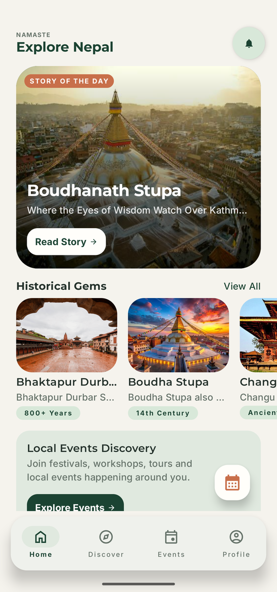
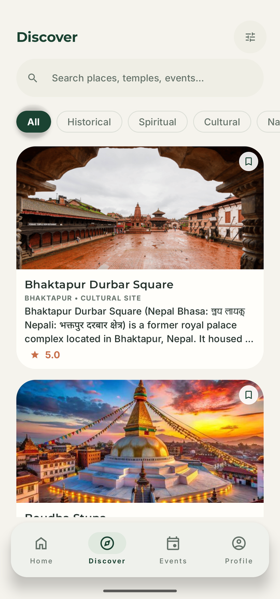
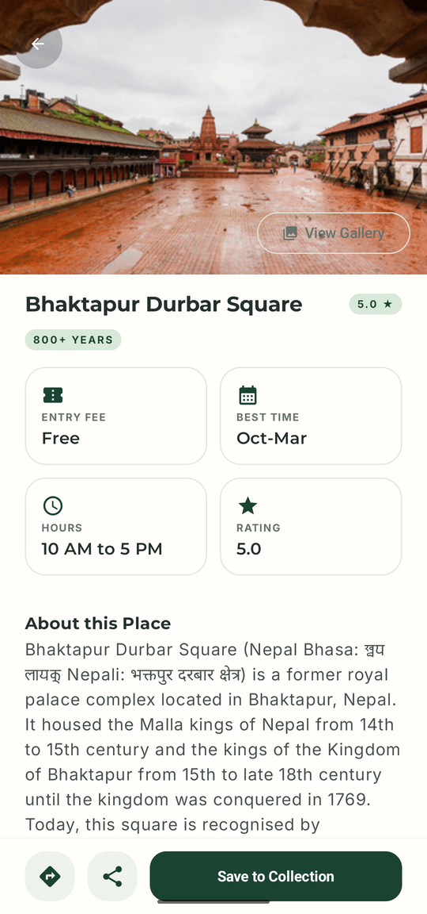
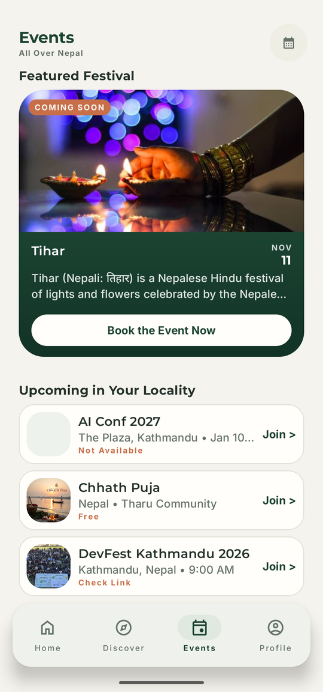

<div align="center">

# 🏔️ Avalokan

### Discover Nepal. Explore its heritage. Experience its stories.

A native Android heritage explorer for Nepal — historical places, cultural stories, festivals, and the details worth knowing before you go.

Built with **Kotlin, Jetpack Compose, and Material 3**, backed by **Firebase** and cached offline in **Room**.

<br/>

[](https://kotlinlang.org/)
[](https://developer.android.com/compose)
[](https://m3.material.io/)


<br/>

**Project status:** Feature-complete beta · Firestore-backed content · Local saves & auth

<br/>

<a href="docs/media/avalokan-launch.mp4">
  
</a>

▶ **[Watch the 22-second launch film](docs/media/avalokan-launch.mp4)** · 1080×1920 · sound on

</div>

---

## 🌄 About the project

Nepal holds centuries of history, living traditions, sacred places, architectural wonders, and festivals that bring communities together. Finding the stories behind those places — and what is happening next — usually means searching across many different sources.

**Avalokan brings those experiences together in one place.** It is a heritage explorer where people can discover destinations, read editorial stories, browse events, save places to a personal collection, and optionally sign in to sync a profile with Firestore.

Content is loaded from **Cloud Firestore** (`places`, `events`, `stories`, `users`) with an **offline-first** cache in **Room**. Saved place IDs, theme, notifications, and avatar preferences live in **DataStore**.

### ✨ Core experience

* 🏛️ **Explore heritage** — historical landmarks, cultural destinations, and religious sites from Firestore.
* 📖 **Read stories** — Story of the Day and story detail screens backed by the `stories` collection.
* 🎉 **Find events** — a featured festival card, upcoming events, and a Book CTA with in-app confirmation.
* 🔎 **Discover places** — search and category-aware heritage cards on the Discover tab.
* 🔖 **Save & collect** — bookmark places locally; collections appear on Profile (no sign-in required).
* 👤 **Your profile** — display name, bio, avatar, saved places, and stats; edits sync to `users/{uid}` when signed in.
* 🔐 **Account (optional)** — anonymous session by default; upgrade via email/password or Google Sign-In.

---

## 📱 Screens

| Home | Discover |
| :---: | :---: |
|  |  |
| **Story of the Day**, Historical Gems, and event discovery | Search, category filters, heritage cards, and save toggles |

| Place details | Events |
| :---: | :---: |
|  |  |
| Facts, story, gallery hook, and Save to Collection | Featured festival and upcoming events, with booking from the card |

<sub>Captured from the running app on a 1080×2400 emulator — the same footage the launch film is cut from.</sub>

### Navigation

| Screen | Experience |
| --- | --- |
| **Home** | Greeting, Story of the Day, Historical Gems, event promotion, recent discoveries |
| **Discover** | Search, category filters, heritage cards, save toggles |
| **Events** | Featured festival and upcoming events list |
| **Profile** | Overview, activity stats, saved collection, settings entry, edit profile |
| **Settings** | Theme, notifications, login/logout, support links, app version |
| **Login** | Email sign-in/sign-up and Google Sign-In |
| **Story details** | Editorial layout for a story document |
| **Place details** | Place info, gallery hook, directions/share, save to collection |
| **Event details** | Event layout, share, and a Book CTA with in-app confirmation |

Navigation lives in `ui/navigation/` (`NavDestination`, `AvalokanNavHost`). Detail routes take string IDs that match Firestore document IDs.

---

## 🎨 Design system

Avalokan uses a custom visual language inspired by Nepal's landscapes, heritage, and cultural warmth — earthy, minimal, and production-ready.

| Element | Implementation |
| --- | --- |
| **Visual direction** | Editorial layouts with heritage-inspired presentation |
| **Color palette** | Forest green `#1B4332`, sage `#6B8F7A`, sand `#E8D7B7`, terracotta `#C86F4A`, warm ivory `#F5F3ED` |
| **Typography** | Montserrat for headings, Inter for body text |
| **UI framework** | Jetpack Compose + Material 3 |
| **Layout system** | 8dp spacing grid, reusable components, category accent colors |
| **Navigation** | Centralized navigation with a floating bottom bar |
| **Window handling** | Edge-to-edge layouts and appropriate system-bar insets |

The goal is a modern, readable interface that makes heritage content feel engaging without overwhelming the information itself.

---

## 🧱 Architecture & technology

The UI talks to **ViewModels**, which consume **repository interfaces** implemented with Firestore snapshot listeners and Room caches. **Hilt** wires dependencies app-wide.

### Technology stack

| Layer | Technologies |
| --- | --- |
| **Language** | Kotlin 2.2.10 |
| **UI** | Jetpack Compose, Material 3, Coil |
| **Navigation** | Navigation Compose 2.10.1 |
| **Dependency injection** | Hilt 2.60.1, KSP |
| **Local persistence** | Room 3 (places, events, stories), DataStore (prefs & saves) |
| **Cloud** | Firebase Auth, Firestore, Analytics |
| **Auth UX** | Credential Manager + Google ID |
| **Build** | Android Gradle Plugin 9.4.1, Java 11 |
| **Testing** | JUnit, Turbine, coroutines-test (unit tests) |

### Architecture overview

```text
┌─────────────────────────────────────┐
│             UI layer                │
│  Home · Discover · Events · Profile │
│  Settings · Login · Detail screens  │
└──────────────────┬──────────────────┘
                   │ ViewModels
                   ▼
┌─────────────────────────────────────┐
│           Repository layer          │
│  Place · Event · Story · User       │
└──────────────────┬──────────────────┘
                   │
         ┌─────────┴─────────┐
         ▼                   ▼
┌─────────────────┐  ┌─────────────────┐
│  Room (cache)   │  │ Firestore (live) │
│  offline reads  │  │ snapshot listeners│
└─────────────────┘  └─────────────────┘

┌─────────────────────────────────────┐
│  AuthRepository · PreferencesStore  │
│  Firebase Auth · DataStore           │
└─────────────────────────────────────┘
```

**Offline-first flow:** repositories emit the Room cache immediately, then merge updates from Firestore listeners into the DAO. Listeners log errors and keep the last good UI state when the network fails.

**Authentication:** `AvalokanApplication` signs in anonymously on first launch so Firestore reads work out of the box. Email/password and Google sign-in link credentials to the anonymous user when possible. Failed email sign-in attempts are rate-limited on-device (hashed email identifier; passwords are never stored — Firebase hashes them server-side).

---

## 📂 Project structure

```text
Avalokan/
├── app/                          # Android application module
├── docs/
│   ├── media/                    # 22s launch film + poster
│   └── screenshots/              # real captures used in this README
├── gradle/libs.versions.toml     # version catalog
├── secrets.properties.example    # OAuth client ID template
└── README.md
```

```text
app/src/main/java/com/example/avalokan/
├── MainActivity.kt
├── AvalokanApp.kt
├── AvalokanApplication.kt
│
├── data/
│   ├── di/                 # Hilt modules
│   ├── local/              # DataStore preferences & saved place IDs
│   ├── auth/               # Firebase Auth, login rate limiting
│   ├── place/ · event/ · story/
│   ├── user/
│   └── AvalokanDatabase.kt
│
└── ui/
    ├── home/ · discover/ · events/ · profile/
    ├── settings/ · auth/
    ├── detail/
    ├── components/
    ├── navigation/
    └── theme/
```

* `MainActivity.kt` — activity entry point, edge-to-edge setup, and theme initialization.
* `AvalokanApp.kt` — main scaffold, floating bottom navigation, and navigation host.
* `AvalokanApplication.kt` — Hilt application entry; anonymous Firebase Auth bootstrap.
* `data/` — repositories, Room entities/DAOs, Firestore mapping, auth, and user profile sync.
* `ui/` — feature screens, detail layouts, shared components, navigation, and design system.

---

## 🚀 Getting started

### Prerequisites

* Android Studio
* JDK 17 or a compatible JDK supported by the project's Gradle setup
* Android device or emulator running Android 7.0 (API 24) or higher

### 1. Clone the repository

```bash
git clone https://github.com/SamratVsn/Avalokan.git
cd Avalokan
```

### 2. Open the project

Open the project in Android Studio and allow Gradle synchronization to complete.

### 3. Configure Firebase

API keys and OAuth client IDs are **not** committed. Set them up locally:

1. Copy `secrets.properties.example` to `secrets.properties` at the repo root and set `GOOGLE_SERVER_CLIENT_ID` to your Firebase **Web client** OAuth ID.
2. Download `google-services.json` from Firebase Console into `app/`, or copy `app/google-services.json.example` and replace placeholders (downloading from Firebase is recommended).

For your own Firebase project:

1. Register the Android app (update `applicationId` in `app/build.gradle.kts` if you change the package name).
2. Enable **Authentication** (Email/Password, Google, Anonymous).
3. Create Firestore collections **`places`**, **`events`**, **`stories`**, and **`users`** with document fields matching the mappers in `*Repository.kt`.
4. Define and deploy **Firestore security rules** appropriate for production (the app expects read access for heritage content and scoped writes for user profiles).

If keys were ever pushed to a public remote, rotate them in [Google Cloud Console](https://console.cloud.google.com/) / Firebase and restrict API key usage (Android app + APIs).

### 4. Build and test

```bash
./gradlew :app:assembleDebug
./gradlew :app:testDebugUnitTest
```

Install the debug APK on a device or emulator, or run from Android Studio.

---

## 🗺️ Roadmap

* [x] Main UI screens, design system, and navigation
* [x] Hilt DI and ViewModels
* [x] Firestore repositories with Room offline cache
* [x] Data-driven Home, Discover, Events, and detail screens
* [x] Local saved-place collections (DataStore)
* [x] Firebase Auth (anonymous, email/password, Google)
* [x] User profile read/write to Firestore
* [x] Search and category filtering on Discover
* [x] 22-second launch film cut from real app captures
* [ ] Persist event bookings to Firestore (in-app confirmation works today)
* [ ] Cloud sync for saved places across devices
* [ ] Calendar export and a notification center
* [ ] Production Firestore rules review and monitoring
* [ ] Release package ID, R8/ProGuard, Play Store listing assets
* [ ] Privacy policy and Data safety disclosure for Play Console

---

## 🎬 Media & credits

The launch film in `docs/media/` is cut from captures of the app running on an emulator — no mockups, no invented screens. It was assembled with [HyperFrames](https://hyperframes.heygen.com).

**Music:** *Happy Beats Business Moves, Vol. 12* by **Sascha Ende** ([ende.app](https://ende.app)), licensed under [CC BY 4.0](https://creativecommons.org/licenses/by/4.0/).

---

## 🤝 Contributing

Avalokan is an evolving project, and suggestions around Android architecture, heritage discovery, UI accessibility, and data modeling are welcome.

If you'd like to contribute:

1. Fork the repository.
2. Create a feature branch.
3. Make your changes.
4. Run unit tests and smoke-test on a device.
5. Open a pull request describing the changes.

---

## 👨‍💻 Author

**Samrat Parajuli**
Android Developer · Kotlin · Jetpack Compose · Nepal 🇳🇵

[Portfolio](https://samratparajuli0.com.np) · [GitHub](https://github.com/SamratVsn) · [LinkedIn](https://www.linkedin.com/in/samratvsn/)

---

<div align="center">

**Discover Nepal. Preserve its stories. Connect with its heritage.**

*Built with curiosity and a love for Nepal.*

</div>
