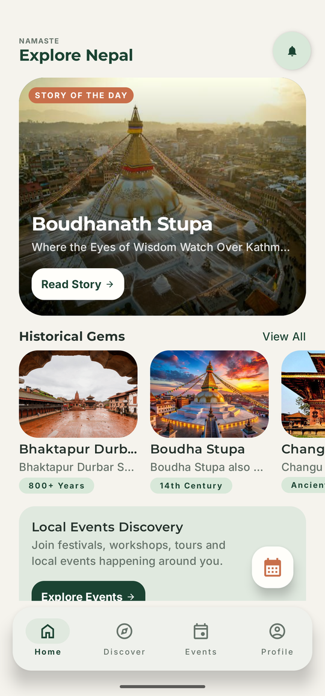
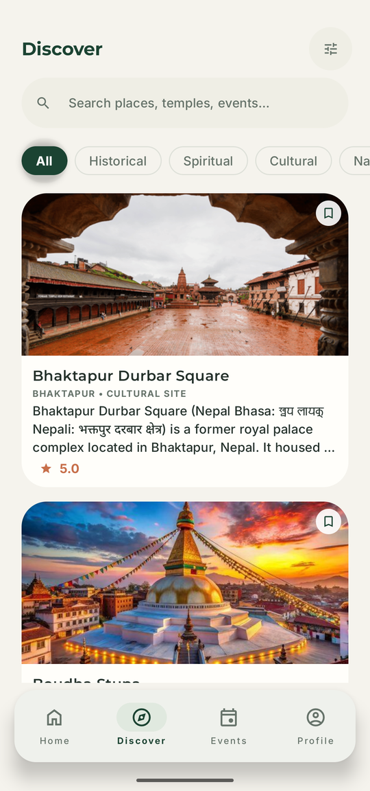
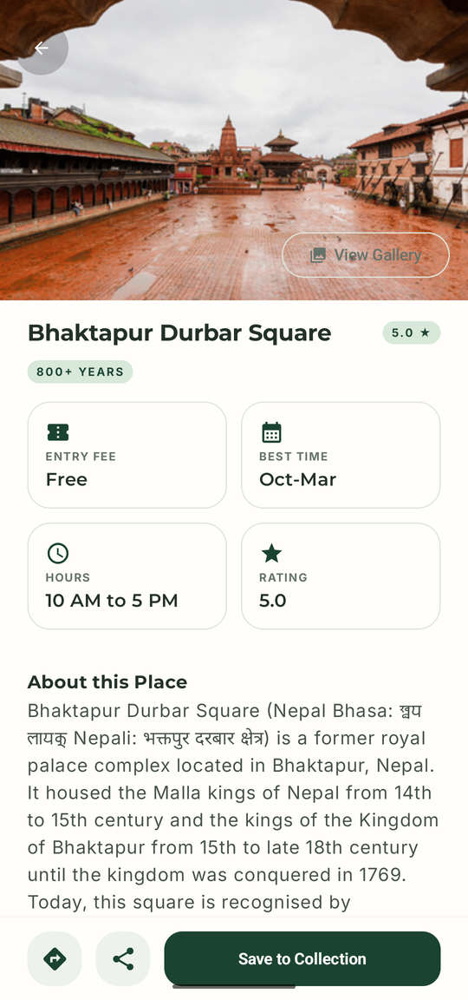
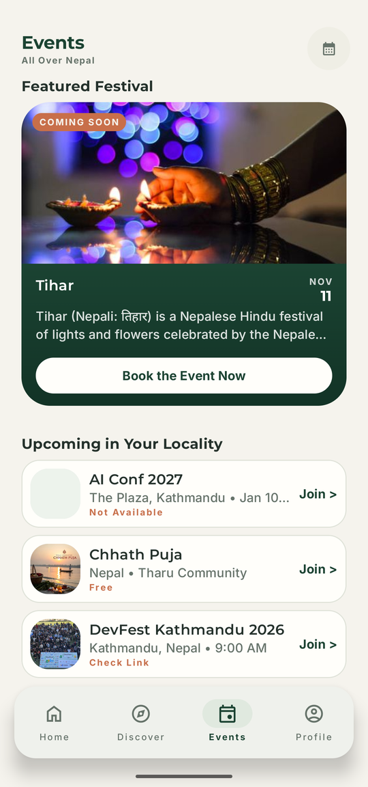

<div align="center">

# 🏔️ Avalokan

### Discover Nepal. Explore its heritage. Experience its stories.

A native Android heritage explorer for Nepal — historical places, cultural stories, festivals, and the details worth knowing before you go.

Built with **Kotlin, Jetpack Compose, and Material 3**, backed by **Firebase** and cached offline in **Room**.

<br/>

[](https://kotlinlang.org/)
[](https://developer.android.com/compose)
[](https://m3.material.io/)


<br/>

**Project status:** Working beta · core flows run end-to-end · **not production- or store-ready**

Core discovery, reading, search, saving, and authentication work today. The production checklist in the roadmap — security rules, monitoring, release hardening, privacy — is still open.

<br/>

<a href="docs/media/avalokan-launch.mp4">
  
</a>

▶ **[Watch the 22-second launch film](docs/media/avalokan-launch.mp4)** · 1080×1920 · sound on

</div>

---

## 🌄 About the project

Nepal holds centuries of history, living traditions, sacred places, architectural wonders, and festivals that bring communities together. Finding the stories behind those places — and what is happening next — usually means searching across many different sources.

**Avalokan brings those experiences together in one place.** It is a heritage explorer where people can discover destinations, read editorial stories, browse events, save places to a personal collection, and optionally sign in to sync a profile with Firestore.

Content is loaded from **Cloud Firestore** (`places`, `events`, `stories`, `users`) with an **offline-first** cache in **Room**. Saved place IDs, theme, notifications, and the local avatar URI live in **DataStore**; the avatar image itself is copied into app-private storage.

### ✨ Core experience

* 🏛️ **Explore heritage** — historical landmarks, cultural destinations, and religious sites from Firestore.
* 📖 **Read stories** — Story of the Day and story detail screens backed by the `stories` collection.
* 🎉 **Find events** — a featured festival card, upcoming events, and a Book CTA that opens the organizer's link (bookings are not persisted yet).
* 🔎 **Discover places** — search and category-aware heritage cards on the Discover tab.
* 🔖 **Save & collect** — bookmark places locally; collections appear on Profile (no sign-in required).
* 👤 **Your profile** — display name, bio, local avatar, saved places, and stats; name and bio edits sync to `users/{uid}` when signed in.
* 🔐 **Account (optional)** — anonymous session by default; upgrade via email/password or Google Sign-In.

---

## 📱 Screens

| Home | Discover |
| :---: | :---: |
|  |  |
| **Story of the Day**, Historical Gems, and event discovery | Search, category filters, heritage cards, and save toggles |

| Place details | Events |
| :---: | :---: |
|  |  |
| Facts, story, gallery hook, and Save to Collection | Featured festival and upcoming events, with an external booking link |

<sub>Captured from the running app on a 1080×2400 emulator — the same footage the launch film is cut from.</sub>

### Navigation

| Screen | Experience |
| --- | --- |
| **Home** | Greeting, Story of the Day, Historical Gems, event promotion, recent discoveries |
| **Discover** | Search, category filters, heritage cards, save toggles |
| **Events** | Featured festival and upcoming events list |
| **Profile** | Overview, activity stats, saved collection, settings entry, edit profile |
| **Settings** | Theme, notifications, login/logout, support links, app version |
| **Login** | Email sign-in/sign-up and Google Sign-In |
| **Story details** | Editorial layout for a story document |
| **Place details** | Place info, gallery hook, directions/share, save to collection |
| **Event details** | Event layout, share, and a Book CTA that opens the organizer's link |

Navigation lives in `ui/navigation/` (`NavDestination`, `AvalokanNavHost`). Detail routes take string IDs that match Firestore document IDs.

---

## 🎨 Design system

Avalokan uses a custom visual language inspired by Nepal's landscapes, heritage, and cultural warmth — earthy, minimal, and consistently applied across every screen.

| Element | Implementation |
| --- | --- |
| **Visual direction** | Editorial layouts with heritage-inspired presentation |
| **Color palette** | Forest green `#1B4332`, sage `#6B8F7A`, sand `#E8D7B7`, terracotta `#C86F4A`, warm ivory `#F5F3ED` |
| **Typography** | Montserrat for headings, Inter for body text |
| **UI framework** | Jetpack Compose + Material 3 |
| **Layout system** | 8dp spacing grid, reusable components, category accent colors |
| **Navigation** | Centralized navigation with a floating bottom bar |
| **Window handling** | Edge-to-edge layouts and appropriate system-bar insets |

The goal is a modern, readable interface that makes heritage content feel engaging without overwhelming the information itself.

---

## 🧱 Architecture & technology

The UI talks to **ViewModels**, which consume **domain repository interfaces**. The place, event, and story repositories map Room rows to domain models at the data boundary, so screens never depend on Room entities. The data implementations share one `FirestoreCachedCollection<T>` helper that keeps **Room as the single source of truth**: Firestore snapshot listeners only write into Room, and every read comes from the Room flow. The helper also handles server refresh and cache clearing. **Hilt** wires dependencies app-wide.

### Technology stack

| Layer | Technologies |
| --- | --- |
| **Language** | Kotlin 2.2.10 |
| **UI** | Jetpack Compose, Material 3, Coil |
| **Navigation** | Navigation Compose 2.10.1 |
| **Dependency injection** | Hilt 2.60.1, KSP |
| **Local persistence** | Room 3 (places, events, stories), DataStore (prefs & saves) |
| **Cloud** | Firebase Auth, Firestore, Analytics |
| **Auth UX** | Credential Manager + Google ID |
| **Build** | Android Gradle Plugin 9.4.1, Java 11 |
| **Testing** | JUnit, Turbine, coroutines-test, AndroidX Test, Compose UI Test |

### Architecture overview

```text
┌─────────────────────────────────────┐
│             UI layer                │
│  Home · Discover · Events · Profile │
│  Settings · Login · Detail screens  │
└──────────────────┬──────────────────┘
                   │ ViewModels
                   ▼
┌─────────────────────────────────────┐
│            Domain layer             │
│  Place · Event · Story models       │
│  Place/Event/Story repository ports │
└──────────────────┬──────────────────┘
                   │ implemented by
                   ▼
┌─────────────────────────────────────┐
│             Data layer              │
│  Firestore repositories · mappers   │
│  Room entities/DAOs · User sync     │
└──────────────────┬──────────────────┘
                   │ observe / refresh
                   ▼
┌─────────────────────────────────────┐
│       Room (single source of truth) │
│  offline reads · one ordered stream │
└──────────────────▲──────────────────┘
                   │ snapshot write-through
┌──────────────────┴──────────────────┐
│     Firestore snapshot listeners    │
└─────────────────────────────────────┘

┌─────────────────────────────────────┐
│  AuthRepository · PreferencesStore  │
│  Firebase Auth · DataStore           │
└─────────────────────────────────────┘
```

**Offline-first flow:** Room is the single source of truth. Repositories expose the Room flow to the UI, while Firestore snapshot listeners only write into Room. A failed listener leaves the last good Room state in place, and a server refresh replaces the cache atomically.

**Cache-only database contract:** the Room database holds only Firestore-derived content (places, events, stories), so a schema change may use `fallbackToDestructiveMigration()` and rebuild from the next snapshot. Schemas are exported to `app/schemas/`; if user-created data is ever stored in Room, replace the destructive fallback with real migrations.

**Authentication:** `AvalokanApplication` signs in anonymously on first launch so Firestore reads work out of the box. Email/password and Google sign-in link credentials to the anonymous user when possible. Failed email sign-in attempts are rate-limited on-device (hashed email identifier; passwords are never stored — Firebase hashes them server-side).

---

## 📂 Project structure

```text
Avalokan/
├── app/                          # Android application module
├── docs/
│   ├── media/                    # 22s launch film + poster
│   └── screenshots/              # real captures used in this README
├── gradle/libs.versions.toml     # version catalog
├── secrets.properties.example    # OAuth client ID template
└── README.md
```

```text
app/src/main/java/com/example/avalokan/
├── MainActivity.kt
├── AvalokanApp.kt
├── AvalokanApplication.kt
│
├── data/
│   ├── di/                 # Hilt modules
│   ├── local/              # DataStore preferences & saved place IDs
│   ├── auth/               # Firebase Auth, login rate limiting
│   ├── firestore/          # shared Firestore + Room cache helper
│   ├── place/ · event/ · story/  # entities, DAOs, repository impls, mappers
│   ├── user/
│   └── AvalokanDatabase.kt
│
├── domain/
│   ├── model/              # UI-facing Place, Event, Story models
│   └── repository/         # repository interfaces consumed by ViewModels
│
└── ui/
    ├── home/ · discover/ · events/ · profile/
    ├── settings/ · auth/
    ├── detail/
    ├── components/
    ├── navigation/
    └── theme/
```

* `MainActivity.kt` — activity entry point, edge-to-edge setup, and theme initialization.
* `AvalokanApp.kt` — main scaffold, floating bottom navigation, and navigation host.
* `AvalokanApplication.kt` — Hilt application entry; anonymous Firebase Auth bootstrap.
* `domain/` — UI-facing models and repository interfaces; Room entities and Firestore documents do not cross this boundary.
* `data/` — repository implementations, Room entities/DAOs, entity-to-domain mappers, Firestore mapping, auth, and user profile sync.
* `ui/` — feature screens, detail layouts, shared components, navigation, and design system.

---

## 🚀 Getting started

### Prerequisites

* Android Studio
* JDK 17 or a compatible JDK supported by the project's Gradle setup
* Android device or emulator running Android 7.0 (API 24) or higher

### 1. Clone the repository

```bash
git clone https://github.com/SamratVsn/Avalokan.git
cd Avalokan
```

### 2. Open the project

Open the project in Android Studio and allow Gradle synchronization to complete.

### 3. Configure Firebase

API keys and OAuth client IDs are **not** committed. Set them up locally:

1. Copy `secrets.properties.example` to `secrets.properties` at the repo root and set `GOOGLE_SERVER_CLIENT_ID` to your Firebase **Web client** OAuth ID.
2. Download `google-services.json` from Firebase Console into `app/`, or copy `app/google-services.json.example` and replace placeholders (downloading from Firebase is recommended).

For your own Firebase project:

1. Register the Android app (update `applicationId` in `app/build.gradle.kts` if you change the package name).
2. Enable **Authentication** (Email/Password, Google, Anonymous).
3. Create Firestore collections **`places`**, **`events`**, **`stories`**, and **`users`** with document fields matching the mappers in `*Repository.kt`.
4. Define and deploy **Firestore security rules** appropriate for production (the app expects read access for heritage content and scoped writes for user profiles).

If keys were ever pushed to a public remote, rotate them in [Google Cloud Console](https://console.cloud.google.com/) / Firebase and restrict API key usage (Android app + APIs).

### 4. Build and test

```bash
./gradlew :app:assembleDebug
./gradlew :app:testDebugUnitTest
./gradlew :app:connectedDebugAndroidTest   # needs a device or emulator
```

Install the debug APK on a device or emulator, or run from Android Studio.

---

## 🗺️ Roadmap

Avalokan is a **working beta**, not a finished product. The sections below deliberately separate three things: what the app does today, what exists but is incomplete, and what has not been done at all.

### ✅ Implemented — works today

| Area | What is actually in the app |
| --- | --- |
| **Screens & navigation** | Home, Discover, Events, Profile, Settings, Login, and place/event/story details |
| **Design system** | Compose + Material 3 theme, typography, colors, reusable cards, and state views |
| **Architecture** | Hilt DI, ViewModels, domain models, and repository interfaces |
| **Data layer** | Firestore repositories backed by a Room cache, with entity-to-domain mappers and one shared `FirestoreCachedCollection<T>` helper |
| **Content** | Places, events, and stories rendered from Firestore |
| **Search** | Discover search, category filters, clear-search, and suggestions when nothing matches |
| **Screen states** | Loading skeletons, empty states, error states, and retry actions on list screens |
| **Local collection** | Saved places and favorite events stored in DataStore |
| **Auth** | Anonymous bootstrap, email/password, and Google Sign-In |
| **Profile** | Display name, bio, local avatar, and name/bio sync to `users/{uid}` |
| **On-device safeguards** | Input validation, sign-in rate limiting, and safe URI/document-ID checks |
| **Media** | 22-second launch film cut from real app captures |

### 🚧 Partially implemented — present, but not finished

| Feature | What works | What is missing |
| --- | --- | --- |
| **Event booking** | The Book CTA opens the event's `joinLink` when one exists | No booking is written to Firestore; the fallback snackbar does not register the user |
| **Notifications** | Settings toggle and Android 13+ permission request | No notification channel, scheduler, local reminders, or push service |
| **Profile stats** | Saved and favorite counts are real | "Visited" is hardcoded to `0` |
| **Calendar** | — | Calendar button is a placeholder; no export or notification center |
| **Cross-device sync** | — | Saved places, favorites, and avatars are not synced across devices and can be lost if app data is cleared |
| **Avatar** | The picked image is copied into app-private storage and displayed from a local `file://` URI | It is device-local and does not sync across devices; there is no remote upload/storage backend |

### 🏭 Unfinished production work — not in this repository

These are release blockers, not features. None of them are implemented:

- [ ] **Firestore security rules** — no `firestore.rules` is committed, and no rules are tested or deployed. Reads and scoped profile writes must be locked down per project.
- [ ] **Monitoring and crash reporting** — no Crashlytics/Sentry, alerting, or error dashboards.
- [ ] **Release identity and signing** — `applicationId` is still `com.example.avalokan`, `versionCode` is `1`, and no release signing config is checked in.
- [ ] **Release build hardening** — release optimization is disabled; there are no R8/ProGuard rules or baseline profile.
- [ ] **Privacy policy and Play Console data-safety disclosure** — not written.
- [ ] **Store listing assets** — store screenshots, feature graphic, and listing copy.
- [ ] **Backend validation and abuse controls** — profile writes come directly from the client with no server-side validation or moderation.
- [ ] **Test coverage** — unit tests cover ViewModels, Firestore document mappers, and the Room-cache policy; instrumentation tests cover DAO transactions and a Compose card. Full screen/navigation flows and live Firestore emulator tests are still missing.
- [ ] **Accessibility audit** — small text, undersized touch targets, and missing content descriptions still need review.
- [ ] **Localization** — English only; no Nepali resource set.
- [ ] **CI** — no automated build/test pipeline.

> **Bottom line:** the client app is feature-rich enough to demo, dogfood, and review as a portfolio project — but the security, release, privacy, monitoring, and testing work above is what separates it from a production app. The checkmarks are not a claim of store readiness.

---

## 🎬 Media & credits

The launch film in `docs/media/` is cut from captures of the app running on an emulator — no mockups, no invented screens. It was assembled with [HyperFrames](https://hyperframes.heygen.com).

**Music:** *Happy Beats Business Moves, Vol. 12* by **Sascha Ende** ([ende.app](https://ende.app)), licensed under [CC BY 4.0](https://creativecommons.org/licenses/by/4.0/).

---

## 🤝 Contributing

Avalokan is an evolving project, and suggestions around Android architecture, heritage discovery, UI accessibility, and data modeling are welcome.

If you'd like to contribute:

1. Fork the repository.
2. Create a feature branch.
3. Make your changes.
4. Run unit tests and smoke-test on a device.
5. Open a pull request describing the changes.

---

## 👨‍💻 Author

**Samrat Parajuli**
Android Developer · Kotlin · Jetpack Compose · Nepal 🇳🇵

[Portfolio](https://samratparajuli0.com.np) · [GitHub](https://github.com/SamratVsn) · [LinkedIn](https://www.linkedin.com/in/samratvsn/)

---

<div align="center">

**Discover Nepal. Preserve its stories. Connect with its heritage.**

*Built with curiosity and a love for Nepal.*

</div>
